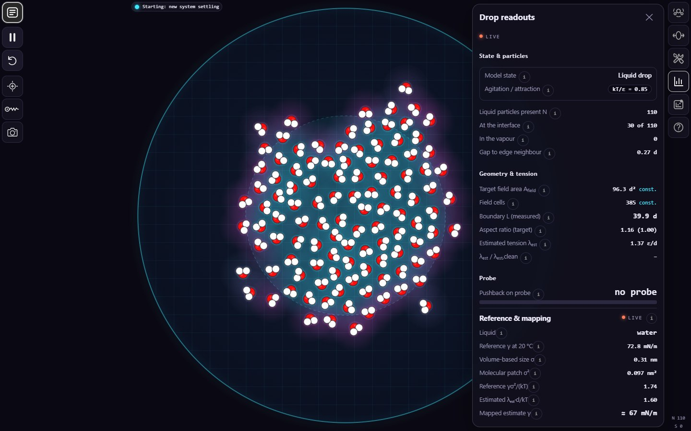

# Let’s Get Cohesive

A bilingual teaching simulation for exploring cohesion, surface tension, surfactants and emulsions. Compare named liquid analogues or use the dance-floor analogy. The recorder plots measurements and exports CSV and PNG files.

| Branch | Address |
| --- | --- |
| `main` | https://lets-get-cohesive.ipt-apps.workers.dev/ |
| `dev` | https://dev-lets-get-cohesive.ipt-apps.workers.dev/ |



## Build and check

Use Node.js 22 or later. The standalone source is in `src/index.html`. The build adds the package version to the credits at the bottom of the Help menu and writes `build/deploy/index.html`. Serve `build/deploy/` with a static server or open its HTML in a browser.

```sh
npm test
npm run build
```

`npm run build -- --baseline` copies the source byte for byte to `build/baseline/index.html`. The baseline mode and regular build require no installed dependencies.

To run the desktop and mobile browser checks:

```sh
npm ci
npx playwright install chromium
npm run test:browser
```

## Deployment

Connect this repository to Cloudflare Workers Builds. Set `main` as the production branch and enable preview builds. Set the build command to `npm run build`, the deploy command to `npx wrangler deploy`, and the preview command to `npx wrangler preview`.

Develop and test on `dev`. For a release, update the package version, merge into `main`, and tag the release.

## License

The app is distributed under the MIT License. The HTML requests Atkinson Hyperlegible, JetBrains Mono, STIX Two Text and Syne from Google Fonts under their respective font licenses. No font files are bundled. The Tailwind CDN script is an external dependency distributed under its own MIT License. Local fallback styles and font stacks are included.
